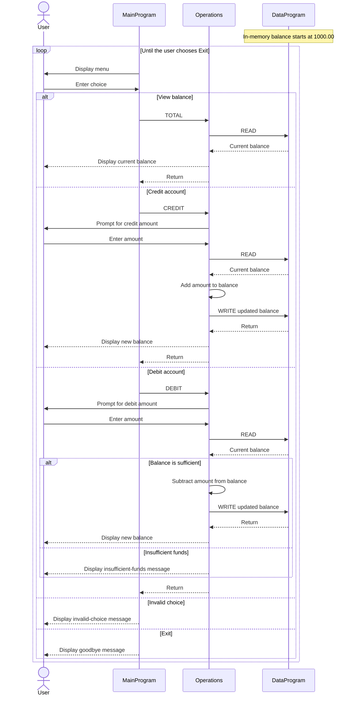

# COBOL Account Management

This directory documents the COBOL programs in `src/cobol`. Together, they
provide a small command-line account manager with one stored balance.

## COBOL files

### `main.cob` — `MainProgram`

Displays the account menu and dispatches the user's selection to `Operations`.

- **1 — View Balance:** calls `Operations` with `TOTAL`.
- **2 — Credit Account:** calls `Operations` with `CREDIT`.
- **3 — Debit Account:** calls `Operations` with `DEBIT`.
- **4 — Exit:** ends the menu loop and stops the program.
- Other choices display an invalid-choice message.

### `operations.cob` — `Operations`

Implements the account actions and interacts with `DataProgram`.

- **View:** reads and displays the current balance.
- **Credit:** accepts an amount, reads the balance, adds the amount, writes
  the updated balance, and displays it.
- **Debit:** accepts an amount and reads the balance. It subtracts and writes
  the amount only when the balance is at least that amount; otherwise, it
  displays an insufficient-funds message without writing a new balance.

### `data.cob` — `DataProgram`

Provides simple in-memory balance storage through its `READ` and `WRITE`
operations. The stored balance starts at `1000.00`. A `READ` copies that value
to the caller's balance field; a `WRITE` replaces the stored value with the
caller's balance. The value is not persisted to a file or database.

## Account rules and limits

- The program manages one balance; it has no student IDs, individual student
  accounts, or student-specific rules in the current implementation.
- The starting balance is `1000.00`.
- A credit increases the balance by the entered amount.
- A debit is allowed only if the balance is greater than or equal to the
  entered amount. An insufficient-funds debit leaves the stored balance
  unchanged.
- Balance and amount fields use `PIC 9(6)V99`: six integer digits and two
  implied decimal digits. The fields are unsigned and do not represent values
  above `999999.99`.
- The programs do not include additional validation for entered amounts,
  such as rejecting zero or negative values, nor do they check whether a
  credit would exceed the field's capacity.

## Application data flow

